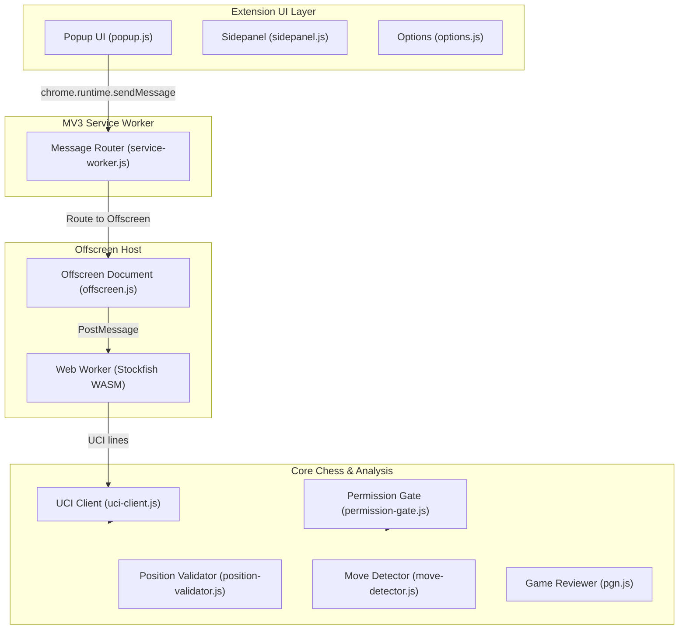

# Chess Agent Extension Architecture

## 1. Architectural Overview

The Chess Agent Extension is engineered around a strict layering principle:

1. **Core Layer (`src/core/`)**: Pure JavaScript running with standard ES modules. It contains zero references to `chrome.*` APIs and zero DOM access. It is completely deterministic, highly testable in Node, and houses all chess rules, move validation, transition detection, UCI engine communication, and compliance safeguards.
2. **Extension Layer (`src/extension/`)**: Contains browser-specific implementations including Chrome Manifest V3 service workers, offscreen documents, extension popups, side panels, options, and content scripts.
3. **Shared Layer (`src/shared/`)**: Message builders, payload validators, constants, and structured error hierarchies shared across both layers.

## 2. Component Responsibilities

### 2.1 Core Chess Engine (`src/core/chess/`)

- **`fen.js`**: Syntax validation, canonical normalization, 6-field parsing, and serialization.
- **`position-validator.js`**: Rules validation using `chess.js`, king count constraints, back-rank pawn illegality, and check status verification.
- **`position-identity.js`**: Equivalence comparison preserving side-to-move, castling rights, and en passant squares.
- **`move-detector.js`**: Detects transitions between consecutive snapshots, verifies single-move candidate matches, and preserves confirmed state on unresolved transitions.
- **`pgn.js`**: Replays completed PGN games, generates move-by-move position snapshots, attaches evaluations, and exports structured review reports.

### 2.2 Local Engine Integration (`src/core/engine/`)

- **`uci-parser.js`**: Deterministic token parsing of Stockfish output (`uciok`, `readyok`, `info`, `bestmove`).
- **`uci-client.js`**: High-level state machine managing the UCI protocol lifecycle (`uci`, `isready`, `position`, `go`, `stop`, `quit`), timeouts, and search cancellation.

### 2.3 Analysis Controller & Compliance Safeguards (`src/core/analysis/`)

- **`permission-gate.js`**: Enforces strict fair-play and platform compliance in code. Engine moves during live human games are strictly blocked.
- **`analysis-controller.js`**: Orchestrates permission validation, position checking, bounded search execution, and result formatting.
- **`result-formatter.js`**: Formats centipawn and mate evaluations with explicit perspective indications (White vs Side-to-move).

### 2.4 Controlled Board Recognition (`src/core/recognition/`)

- **`square-mapper.js`**: Maps algebraic coordinates across orientations (`white-bottom` vs `black-bottom`).
- **`confidence.js`**: Computes piece and board completeness scores. Rejects incomplete or uncertain positions.
- **`position-differ.js`**: Compares piece layouts to detect board deltas.

## 3. Engine Hosting & Manifest V3 Compatibility

Due to Chrome MV3 service worker lifecycle constraints (idle timeouts after 30 seconds), long-running engine searches are hosted within a dedicated **Offscreen Document** (`src/extension/offscreen/offscreen.html`).
The background service worker acts strictly as a stateless, minimal message router.

Engine WebAssembly binary (`public/engine/stockfish/stockfish.wasm`) is bundled directly with the extension package. Zero remote executable code is downloaded at runtime.
